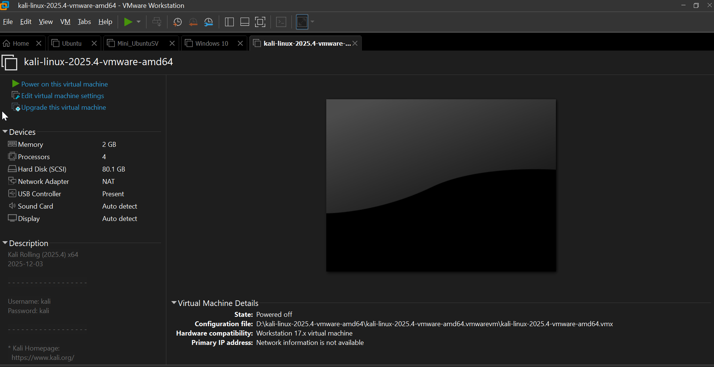
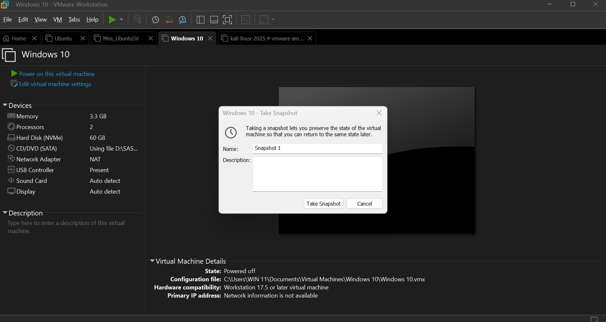
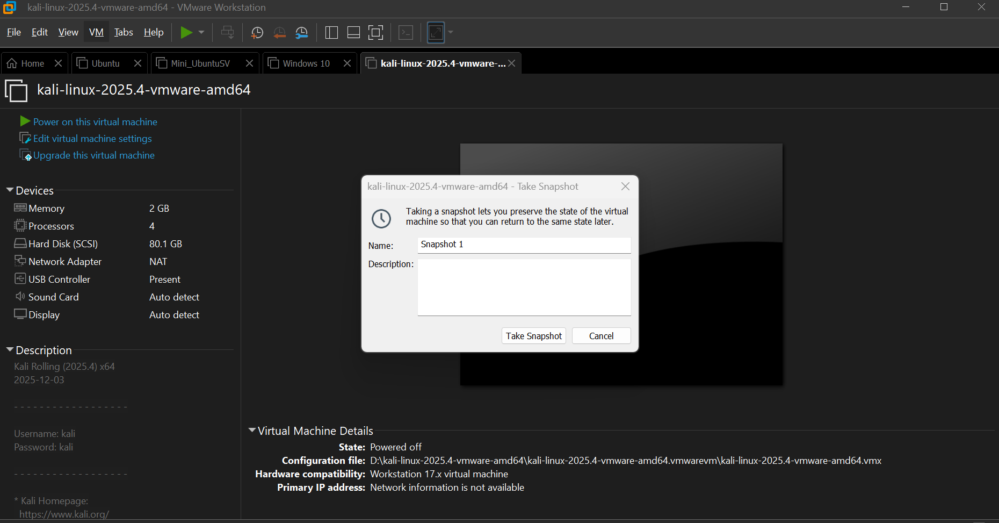

# 🛡️ Virtual Cybersecurity Home Lab

**Building an isolated virtual lab for penetration testing and ethical hacking practice** 🧪💻


---

## 📑 Table of Contents

- [📌 Project Overview](#-project-overview)
- [🎯 Objectives](#-objectives)
- [🛡️ Purpose of the Lab](#️-purpose-of-the-lab)
- [🏗️ Lab Architecture](#️-lab-architecture)
- [🖥️ Virtual Machines & Specifications](#️-virtual-machines--specifications)
- [⚙️ Network Configuration](#️-network-configuration)
- [🪜 Setup Process (Step by Step)](#-setup-process-step-by-step)
- [✅ Verification & Testing](#-verification--testing)
- [📸 Snapshots](#-snapshots)
- [📚 What I Learned](#-what-i-learned)
- [🧯 Problems Encountered & Fixes](#-problems-encountered--fixes)
- [🚀 Future Improvements](#-future-improvements)
- [⚠️ Legal & Ethical Use](#️-legal--ethical-use)

---

## 📌 Project Overview

This project focuses on setting up a **virtual cybersecurity and penetration-testing laboratory** using **VMware Workstation Pro** and **Kali Linux**. 🐉

The purpose of the lab is to create a controlled environment where cybersecurity tools, network scanning, reconnaissance, vulnerability assessment, and other security-testing activities can be performed **safely and repeatedly**.

The lab runs on a private virtual network (NAT), so every machine can talk to each other and reach the internet, while staying separated from the real home/office network. More machines can be added later and used as targets for authorized security testing. 🎯

---

## 🎯 Objectives

The main objectives of this project are to:

- ✅ Install and configure **VMware Workstation Pro**
- ✅ Install/import **Kali Linux** as a virtual machine
- ✅ Build additional VMs: **Ubuntu Desktop**, **Ubuntu Server** and **Windows 10**
- ✅ Create a private **NAT network** for the cybersecurity lab
- ✅ Configure network connectivity for every VM
- ✅ Assign a consistent IP address to each VM
- ✅ Verify network connectivity and DNS resolution
- ✅ Take a clean VM **snapshot** for recovery
- ✅ Document the complete setup process 📝
- ✅ Prepare the environment for future cybersecurity projects

---

## 🛡️ Purpose of the Lab

The lab provides an **isolated and controlled environment** for cybersecurity learning and authorized security testing.

It can be used for activities such as:

| 🔍 Activity | 📖 Description |
|---|---|
| 🌐 Network reconnaissance | Discovering hosts and services on the lab network |
| 🚪 Port scanning | Finding open ports and running services |
| 🐞 Vulnerability assessment | Identifying weaknesses in target machines |
| 📡 Packet analysis | Capturing and inspecting network traffic |
| 🕸️ Web security testing | Testing web apps for common flaws |
| 💥 Exploitation practice | Practising exploits safely on owned targets |
| 🧰 Security-tool experimentation | Trying out and learning new tools |

> ⚠️ **Important:** This laboratory must only be used on systems that you own or have **explicit permission** to test. Do not use the lab or its tools to attack unauthorized systems.

---

## 🏗️ Lab Architecture

```
                        🌍 Internet
                            │
                     ┌──────┴──────┐
                     │  Host PC 💻  │
                     │ VMware WS Pro│
                     └──────┬──────┘
                            │
              🔀 NAT Network 192.168.58.0/24
                            │
     ┌──────────────┬───────┴───────┬──────────────┐
     │              │               │              │
 🐉 Kali Linux   🪟 Windows 10   🐧 Ubuntu      🖥️ Ubuntu
 (Attacker)      (Target)        Server          Desktop
 .162            .174            (Target) .175   (Target) .173
```

> 💡 Additional target machines can be added to the same virtual network in future projects.

📷 **Lab architecture screenshot:**


---

## 🖥️ Virtual Machines & Specifications

| 🏷️ Machine | 🧩 Role | 🧠 RAM | ⚡ Processors | 💾 Storage | 🌐 IP Address |
|---|---|---|---|---|---|
| 🐉 **Kali Linux** | Attacker machine | 2 GB | 4 | 80.1 GB | `192.168.58.162` |
| 🪟 **Windows 10** | Target / client | 3.3 GB | 2 | 60 GB | `192.168.58.174` |
| 🐧 **Ubuntu Server (mini)** | Target / server | 2.3 GB | 2 | 18 GB | `192.168.58.175` |
| 🖥️ **Ubuntu Desktop** | Target / workstation | 4 GB | 2 | 60 GB | `192.168.58.173` |

**Total allocated:** ~11.6 GB RAM 🧠 and 10 virtual processors ⚡ (shared with the host system).

### 📸 Machine Specification Screenshots

#### 🐉 Kali Linux


#### 🪟 Windows 10


#### 🐧 Ubuntu Server


#### 🖥️ Ubuntu Desktop


---

## ⚙️ Network Configuration

A dedicated **NAT network** was used so that all VMs share one private subnet and also have outbound internet access.

```
Network Type : NAT (VMware virtual network)
Subnet       : 192.168.58.0/24
DHCP         : Enabled
IPv6         : Disabled
```

### 🔀 Why NAT?

Multiple virtual machines connected to the same NAT network can **communicate with one another** while also having **outbound network connectivity**. The VMs are hidden from the outside network, which keeps the lab isolated and safe. 🔒 This allows future attacker and target VMs to communicate inside the lab.

### 🗺️ IP Address Plan

| 🏷️ Machine | 🌐 IP Address |
|---|---|
| 🐉 Kali Linux | `192.168.58.162` |
| 🖥️ Ubuntu Desktop | `192.168.58.173` |
| 🪟 Windows 10 | `192.168.58.174` |
| 🐧 Ubuntu Server | `192.168.58.175` |

### 📸 Network Interface Screenshots

#### 🐉 Kali Linux – IP configuration (`ip a`)


#### 🪟 Windows 10 – IP configuration (`ipconfig`)


#### 🐧 Ubuntu Server – IP configuration (`ip a`)


#### 🖥️ Ubuntu Desktop – IP configuration (`ip a`)


#### 🔧 VMware Virtual Network Editor (NAT settings)


---

## 🪜 Setup Process (Step by Step)

### 1️⃣ Install VMware Workstation Pro
Download and install VMware Workstation Pro on the host machine, then confirm that virtualization is enabled in BIOS/UEFI.

📷 *Screenshot:*


### 2️⃣ Create the Virtual Machines
Create/import each VM and allocate resources according to the specification table above.

- 🐉 Import or install **Kali Linux**
- 🪟 Install **Windows 10**
- 🐧 Install **Ubuntu Server**
- 🖥️ Install **Ubuntu Desktop**

### 3️⃣ Configure the NAT Network
Open **Edit → Virtual Network Editor**, select the NAT network and set the subnet to `192.168.58.0/24` with DHCP enabled. Set every VM's network adapter to **NAT**.

📷 *Screenshot:*


### 4️⃣ Assign IP Addresses
Configure and assign an IP address to every machine (see the IP Address Plan above).

**Example – checking the IP on Linux:**
```bash
ip a
```

**Example – checking the IP on Windows:**
```cmd
ipconfig
```

### 5️⃣ Install VMware Tools / Guest Additions
Install VMware Tools (or `open-vm-tools` on Linux) for better screen resolution, clipboard sharing and performance.

```bash
sudo apt update
sudo apt install -y open-vm-tools open-vm-tools-desktop
```

### 6️⃣ Update All Machines
```bash
sudo apt update && sudo apt full-upgrade -y
```

---

## ✅ Verification & Testing

After configuration, connectivity was tested between the machines and to the internet. 🌍

### 📶 Test 1 – Ping between machines (from Kali)
```bash
ping -c 4 192.168.58.173   # Ubuntu Desktop
ping -c 4 192.168.58.174   # Windows 10
ping -c 4 192.168.58.175   # Ubuntu Server
```

📷 *Screenshot:*


### 🌐 Test 2 – Internet access & DNS resolution
```bash
ping -c 4 8.8.8.8          # internet connectivity
ping -c 4 google.com       # DNS resolution
```

📷 *Screenshot:*


### 🔎 Test 3 – Basic host discovery (authorized lab only)
```bash
nmap -sn 192.168.58.0/24
```

📷 *Screenshot:*


| ✅ Test | 🎯 Expected Result | 📋 Status |
|---|---|---|
| Kali → Ubuntu Desktop | Replies received | ⬜ Pass / ⬜ Fail |
| Kali → Windows 10 | Replies received* | ⬜ Pass / ⬜ Fail |
| Kali → Ubuntu Server | Replies received | ⬜ Pass / ⬜ Fail |
| Internet access | Replies received | ⬜ Pass / ⬜ Fail |
| DNS resolution | Domain resolves | ⬜ Pass / ⬜ Fail |

\* Windows Firewall blocks ICMP (ping) by default, so you may need to allow it for testing.

---

## 📸 Snapshots

A **clean snapshot** of each VM was taken right after setup so the lab can be restored quickly if something breaks or a test goes wrong. 🔄

**How to take a snapshot:** `VM → Snapshot → Take Snapshot…`

| 🏷️ Machine | 📛 Snapshot Name | 📝 Description |
|---|---|---|
| 🐉 Kali Linux | `Clean-Install` | Fresh install, network configured |
| 🪟 Windows 10 | `Clean-Install` | Fresh install, network configured |
| 🐧 Ubuntu Server | `Clean-Install` | Fresh install, network configured |
| 🖥️ Ubuntu Desktop | `Clean-Install` | Fresh install, network configured |

📷 *Screenshots:*





---

## 📚 What I Learned

- 🔀 **NAT vs NAT Network** – how each mode handles VM-to-VM and internet traffic
- 🌐 **Virtual machine networking** – adapters, subnets and DHCP
- 📌 **Static IP configuration** – assigning consistent addresses to lab machines
- 📸 **VM snapshots** – saving clean states and recovering quickly
- 📝 **Documentation** – recording a technical setup clearly and professionally
- 🛡️ **Security & ethical use** – testing only systems I own or have permission to test

---

## 🧯 Problems Encountered & Fixes

| 🚧 Problem | 💡 Cause / Fix |
|---|---|
| 🔌 **Network adapter misconfiguration** (bridged vs. NAT vs. host-only causing routing/isolation failures) | Set all VMs to the same adapter type (NAT) and verified in the Virtual Network Editor |
| 🧠 **Excessive resource allocation** (CPU, RAM and disk overcommitment freezing the host) | Reduced RAM/CPU per VM and avoided running every VM at full load at the same time |
| 🌐 **IP address / DHCP subnet conflicts** between host, router and virtual adapters | Chose a separate subnet (`192.168.58.0/24`) and assigned unique IPs |
| 📡 **Kali tools failing** due to missing promiscuous mode settings | Enabled promiscuous mode on the virtual network adapter |
| 🦠 **Host antivirus / Windows Defender deleting security tools** inside Kali | Added exclusions for the VM folder on the host |
| 🧩 **Guest Additions / VMware Tools** installation and resolution scaling issues | Installed `open-vm-tools` and adjusted the display settings |
| ⚙️ **Nested virtualization disabled** in BIOS/UEFI blocking 64-bit guest OS | Enabled Intel VT-x / AMD-V in BIOS/UEFI |
| 🏷️ **Interface naming differences** (e.g. `eth0` vs. `wlan0` in Kali for wireless/MITM work) | Checked the interface name with `ip a` before running tools |

---

## 🚀 Future Improvements

- 🎯 Add intentionally vulnerable targets (Metasploitable, DVWA, etc.)
- 🧱 Deploy a firewall/router VM such as pfSense
- 📊 Set up a SIEM or log server (Wazuh, Splunk, ELK)
- 🔐 Practice hardening the Ubuntu and Windows machines
- 🧪 Build separate attacker, target and monitoring network segments
- 🤖 Automate setup with scripts

---

## ⚠️ Legal & Ethical Use

This lab is for **educational and authorized testing purposes only**. 🎓

- ✅ Only test systems that you **own** or have **written permission** to test
- ❌ Never use these tools against networks or devices you do not control
- 📜 Follow all applicable laws and regulations in your country

---

## 👤 Author

**Your Name** ✍️
🔗 GitHub: [code8-web](https://github.com/code8-web)
💼 LinkedIn: [your-profile](https://linkedin.com/in/your-profile)

⭐ *If you found this project helpful, give it a star!*
